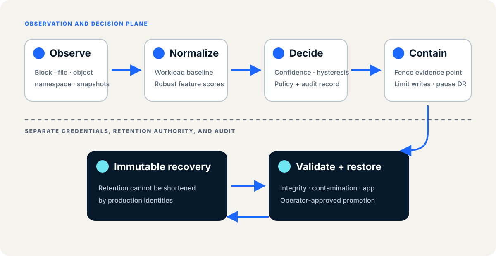
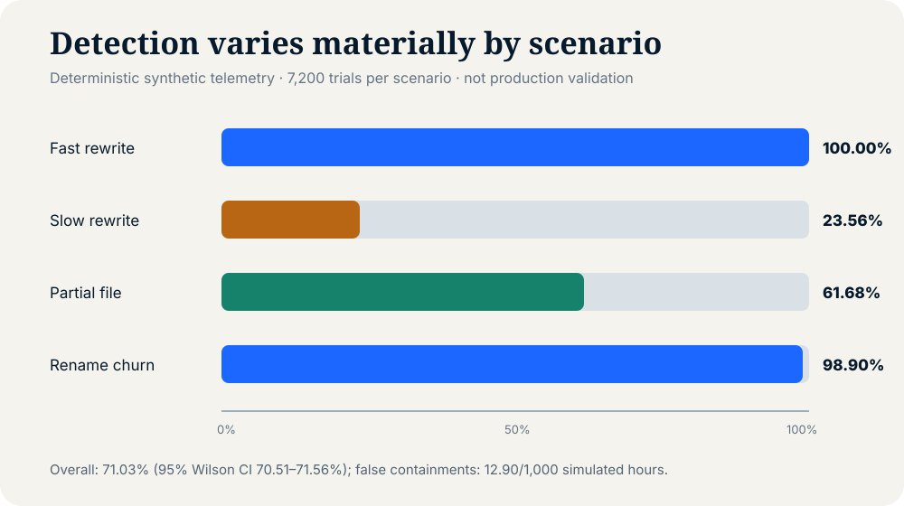

# Storage Ransomware Resilience

[](https://darisisuresh.github.io/storage-ransomware-resilience/)
[](LICENSE)
[](evidence/results/README.md)

**Website:** https://darisisuresh.github.io/storage-ransomware-resilience/

Public evidence companion for the private research manuscript *Storage-Centric Ransomware Resilience: Multi-Signal Detection, Reversible Containment, and Validated Recovery*.

The project describes a vendor-neutral control plane that joins storage telemetry, workload-aware anomaly scoring, reversible containment, immutable recovery points, and isolated recovery validation. This repository intentionally excludes the manuscript and raw integrity reports.

## Research boundary

The repository now includes a deterministic numeric-telemetry benchmark in addition to the architecture and evaluation protocol. Its observations validate the reference implementation only under declared synthetic distributions; they are not malware execution, production measurements, universal detection accuracy, or guaranteed recovery.



## Reproducible findings

Across 40 deterministic seeds, six workload profiles, six benign confounders, and 28,800 adversarial trials, the calibrated reference detector observed a 71.03% aggregate detection rate (95% Wilson CI: 70.51–71.56%) and 12.90 false containment transitions per 1,000 simulated benign workload-hours. Slow rewriting was detected in only 23.56% of trials, exposing an important limitation rather than a universal result.

All numerical detector parameters and per-workload calibrated threshold ranges are published in the generated JSON. All 26 false transitions occur in the synthetic compression profile (270.83 per 1,000 compression-hours); the repository does not present that emulator-specific rate as field performance. Recovery workflow logic is regression-tested, while snapshot integrity, application consistency, and physical restore time remain explicitly unmeasured.



## Repository contents

- `docs/` — responsive project website
- `evidence/architecture.md` — sanitized architectural specification
- `evidence/evaluation-protocol.md` — reproducible test plan
- `evidence/integrity-scan.md` — sanitized final-version integrity scan status
- `evidence/results/` — aggregate results, trial data, and checksums
- `src/storage_resilience.py` — safe numeric telemetry emulator and detector
- `scripts/run_experiments.py` — deterministic benchmark runner
- `scripts/privacy_check.py` — publication privacy gate
- `tests/` — privacy-check regression tests

## Validate

```bash
python3 scripts/privacy_check.py
python3 scripts/privacy_check.py --history
python3 -m unittest discover -s tests -v
python3 scripts/run_experiments.py
```

## Citation

```bibtex
@article{darisi_storage_ransomware_resilience,
  author = {Suresh Kumar Darisi},
  title = {Storage-Centric Ransomware Resilience: Multi-Signal Detection, Reversible Containment, and Validated Recovery},
  year = {2026},
  note = {Manuscript under preparation},
  url = {https://github.com/darisisuresh/storage-ransomware-resilience}
}
```

## Author

**Suresh kumar Darisi**

## License

Code is provided under the MIT License. Documentation is provided under CC BY 4.0. Third-party names remain the property of their respective owners.
